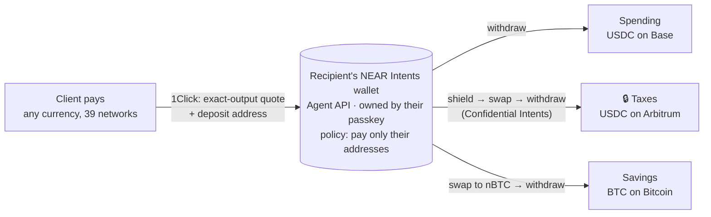

# Allot

**Get paid in anything. Sorted by your rules.**

Allot is a payment link for freelancers and small businesses anywhere. Your client pays with whatever they hold: 200+ currencies on 39 networks. Every payment is split the moment it lands, into **pots** you choose: 70% to spend as USDC on Base, 20% set aside for taxes (privately), 10% saved as Bitcoin. Each pot pays out to its own wallet, on its own network, in its own currency.

It's built on **NEAR Intents**: the [1Click API](https://docs.near-intents.org/) for cross-chain payments, and the **NEAR Intents Agent API** for a wallet that only the recipient's passkey controls and that can **only ever pay the recipient's own addresses**. There's no custom smart contract. The safety rules are enforced by NEAR, not by Allot's server.

**Hackathon tracks:** `realworld` (main) · `privacy` · `security` · `open`

> Live demo: _link added after deploy_ · Video: _link added after recording_

---

## Try it in 60 seconds: no wallet, no money, no keys

```bash
npm install
npm run dev
# open http://localhost:3000/demo
```

The demo and the fee preview need **no API keys**: they use public 1Click *dry* quotes, which create and send nothing.

| Do | You'll see |
|---|---|
| Open **/demo** | A payment link for a sample business, "Ada Design Studio", and a **live** NEAR price for paying $250 in ETH on Arbitrum. |
| Change the amount or currency | The price and every pot's estimate update live. |
| Look at **Ada's pots** | What actually arrives in each pot after fees: Spending (USDC on Base), Taxes (🔒 private, USDC on Arbitrum) and Savings (BTC). Small Bitcoin amounts show a visibly higher fee and ~8 min. |
| Press **Simulate payment** | The payment journey, then the exact steps the real split engine runs per pot: *making private → converting → sending*. Timed from NEAR's own estimates, so Bitcoin finishes last. |
| Press **Send Ada's money to a stranger** | The real `403 policy_destination_denied` that NEAR returned when we tried this on mainnet. |
| Open **/create**, give a Bitcoin pot 2% | The "If you're paid $1,000" card shows what arrives per pot; the tiny Bitcoin pot turns amber with its fee (~8%). |

Without a 1Click partner key, quotes include 1Click's default fee, so numbers differ slightly from a configured deployment.

## The full flow (with keys)

Creating a link makes a **real, empty, policy-locked wallet on NEAR mainnet**, so it needs the keys in [.env.example](.env.example). No funds are needed to set up.

| Step | Do | You'll see |
|---|---|---|
| 1 | **/create**: your name, a link name, and up to 5 pots (name, share, payout currency, your wallet address). Optionally switch a pot to **Private**. | A live "If you're paid $1,000" preview with fees. Private isn't offered where NEAR can't route it (USDT on Tron, TON, BNB Chain). |
| 2 | **Create my payment link** | Three passkey prompts: create the passkey; confirm your pots (creates the wallet with its policy); turn on auto-split (grants Allot's server permission to act *inside* that policy). |
| 3 | Open **/pay/&lt;link name&gt;** as a client | Six one-tap currencies (or search all of them), an exact live price, then a payment address and QR code. |
| 4 | **/pay/status/&lt;id&gt;** | The payment's progress, then each pot's progress, with the private pot shown only as "🔒 Private pot · 20%". |
| 5 | **/dashboard/&lt;link name&gt;** | Passkey sign-in, then: payments, totals per pot, a request-a-payment link builder, CSV export for an accountant, "Retry delayed pots", and renewal of the auto-split permission. |

`npm run e2e` runs steps 1 to 5 with a software passkey against NEAR mainnet (21 checks). Start `npm run dev` first.

---

## How it uses NEAR



1. **One wallet per link, owned by a passkey.** Setup sends the Agent API an `agent_create` intent signed with the recipient's **WebAuthn passkey** (P-256). The wallet's **policy** is built from their pots ([policy.ts](src/lib/server/near/policy.ts)):
   - `actions: ["swap", "withdraw"]`, with no `transfer`;
   - `destinations: { mode: "only", list: <the recipient's own addresses> }`;
   - `assets`: only the currencies their pots use;
   - `confidential`: on only if a pot is private.
2. **Allot's server acts only inside that policy.** A second passkey-signed `grant_issue` gives the server a grant token (the owner signs only its SHA-256 commitment). The token is stored encrypted (AES-256-GCM) and lasts 90 days; the owner renews it from the dashboard. If Allot's server were compromised, the policy would still only pay the recipient's own addresses.
3. **Payments land as USDC.** The pay page asks 1Click for an `EXACT_OUTPUT` quote into the wallet's Intents account. The client can pay with anything 1Click supports, and the recipient receives the exact invoiced amount ([pay/quote](src/app/api/pay/quote/route.ts)).
4. **The split engine** ([split.ts](src/lib/server/payments/split.ts)) turns each pot into steps on the wallet:
   - **private pots:** `shield` into the confidential balance, then a `confidential: true` swap and withdraw;
   - **Bitcoin pots:** swap to **nBTC**, then withdraw to the Bitcoin chain. On 11 Nov, 1Click had no liquidity into BTC held inside Intents, while nBTC filled in about 10 s ([payout-asset.ts](src/lib/server/near/payout-asset.ts));
   - **all other pots:** swap if needed, then `withdraw` to the pot's address.

   Every call carries a deterministic `Idempotency-Key`, so a repeated trigger can't move funds twice.
5. **Estimates** (demo, fee preview) are 1Click **dry** quotes, sent with placeholder recipients and never users' addresses ([quotes.ts](src/lib/server/near/quotes.ts)).

## Security model

| Threat | What stops it |
|---|---|
| Allot's server (or its database) is compromised | The wallet's NEAR policy only pays the recipient's own addresses. Tested on mainnet: a withdrawal to an unlisted address → `403 policy_destination_denied`. |
| Someone else edits a recipient's pots | Changing the policy needs the owner's passkey (`policy_update`). The server only ever holds a grant. |
| A retry pays twice | Deterministic idempotency keys. A manual retry resubmits only what NEAR reported `FAILED`/`REFUNDED`; anything in flight is re-checked instead ([db.ts](src/lib/server/db.ts)). |
| Dashboard takeover | Passkey sign-in verified server-side (challenge, origin, RP ID, user-verification flag, ECDSA signature), with single-use 2-minute challenges and an HMAC-signed 12-hour cookie ([webauthn.ts](src/lib/server/auth/webauthn.ts), [session.ts](src/lib/server/auth/session.ts)). |
| Spam or retry exhaustion | Per-IP rate limits on public endpoints ([rate-limit.ts](src/lib/server/rate-limit.ts)); retries paced to one every 5 s per pot. |
| Spreadsheet formula injection | Payer-written memos are neutralised in the CSV export. |

## Privacy, and its limits

A **private pot** goes through **NEAR Confidential Intents** (on `intents.far`), so the route from the payment link's wallet to that pot's address isn't on the public NEAR chain. Payers see it only as "🔒 Private pot · 20%", with no name, currency or address.

Limits, as the Agent API itself documents them: this is access control, not cryptography. The network's operators can read confidential state, the 1Click solver layer sees each intent, the shield step is public, and the final payout is public on its destination chain (it can be matched by amount and timing). The app says this next to the switch.

## Status: what has been verified

| What | How | Result |
|---|---|---|
| Policy blocks unapproved addresses | [spike/agent-policy-test.mjs](spike/agent-policy-test.mjs), mainnet, 8 Nov | Live withdrawal to a stranger → `403 policy_destination_denied` |
| Privacy must be switched on by the owner | [spike/confidential-test.mjs](spike/confidential-test.mjs), mainnet, 11 Nov | `shield` with confidential off → `403 policy_action_denied`. After the owner's `policy_update` it passes policy. A confidential withdrawal to a stranger is still blocked. |
| Which pots can be private | [spike/confidential-payouts.mjs](spike/confidential-payouts.mjs), dry previews | Every payout option except USDT on Tron, TON and BNB Chain |
| Full setup, renewal, payer quote, dashboard security | `npm run e2e`, mainnet, empty wallet | 21 checks pass |
| Split-engine edge cases | `npm test`, offline against a mock NEAR API | 8 checks pass: retries, missing amounts, review pauses, nothing spendable yet |
| The split engine's live calls | A simulated "paid" payment against an empty wallet | Withdraw, shield and the nBTC swap each stop only at "insufficient balance": accepted by policy |
| A payment with real money, end to end | Manual | **Pending: planned before submission.** |

The Agent API describes itself as an *experimental, mainnet-only beta*. Keep amounts small.

## Run it yourself

Requires **Node.js 24+** (it uses the built-in `node:sqlite`).

```bash
npm install
cp .env.example .env       # then fill in the keys (see below)
npm run dev                # http://localhost:3000
```

| Variable | Needed for | Get it from |
|---|---|---|
| `NEAR_INTENTS_AGENT_API_URL` | creating links, splitting | `https://api.demo.agentsonintents.com` |
| `NEAR_INTENTS_AGENT_API_KEY` | creating links, splitting | partners.demo.agentsonintents.com/dashboard |
| `ALLOT_SECRET` | encrypting grants, signing sign-in cookies | any 32+ random characters |
| `NEAR_INTENTS_API_KEY` | optional: 1Click partner key (lower fees) | partners.near-intents.org |
| `ALLOT_DB_PATH`, `ALLOT_PROXY_HOPS` | optional | see [.env.example](.env.example) |

| Command | What it does |
|---|---|
| `npm run dev` / `npm run build` / `npm start` | Run, build, serve |
| `npm test` | Offline unit tests (no keys) |
| `npm run e2e` | Full setup flow on NEAR mainnet with a software passkey (needs keys and `npm run dev`) |
| `npm run lint` / `npm run typecheck` | ESLint / TypeScript |
| `POST /api/split/sweep` | Advances every unfinished split; call it from a cron job in production |

The app keeps its data in a SQLite file, so deploy it as **one** server process with a persistent disk (e.g. Railway, Render or Fly.io).

## Code map

```
src/
├── app/
│   ├── (marketing)/page.tsx        landing page (3D hero)
│   ├── (app)/create/               create a link (form, pots, live fee preview)
│   ├── (app)/pay/[handle]/         the client's pay page
│   ├── (app)/pay/status/[id]/      live payment and split status
│   ├── (app)/dashboard/[handle]/   owner dashboard (passkey sign-in)
│   ├── (app)/demo/                 demo mode
│   └── api/                        route handlers (links, pay, estimates, auth, dashboard, sweep)
├── components/ui/ · landing/       shared UI · landing animation
└── lib/
    ├── assets.ts · rules.ts        payout options, address checks, pot rules (browser + server)
    └── server/
        ├── near/                   Agent API, 1Click, policy, grant, quotes, payout routes
        ├── payments/               split engine, payment refresh
        ├── auth/                   passkey verification, sessions
        └── db.ts · seal.ts · rate-limit.ts · http.ts · env.ts · fx.ts
tests/   unit/ (npm test) · e2e/ (npm run e2e)
spike/   the mainnet experiments cited above (own package.json: cd spike && npm install)
docs/    PLAN.md (decisions and progress log) · RESEARCH.md (hackathon research)
```

## Out of scope

Cashing out to bank accounts · tax or KYC compliance (the CSV is for records) · recurring billing · mobile apps.

## Credits and license

Token and network logos come from [@web3icons/core](https://github.com/0xa3k5/web3icons) (MIT); the logos are trademarks of their projects and are shown only to identify supported currencies. Allot's own code is under the [MIT License](LICENSE).
